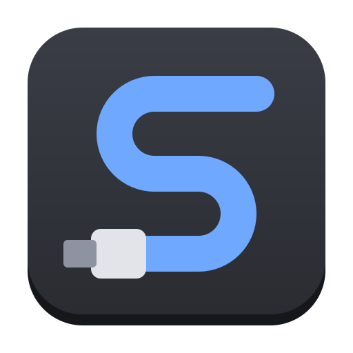

<p align="center">
  
</p>

<h1 align="center">Softsink</h1>

<p align="center">
  <strong>Turn your Linux laptop or tablet into a low-latency monitor.</strong>
</p>

<p align="center">
  Softsink displays video and plays audio from any UVC capture card in a clean, borderless Wayland window.
  Plug in a capture card and start viewing immediately -- low latency, automatic audio passthrough, and controls that stay out of your way.
</p>

<p align="center">
  <a href="https://github.com/ryanpetris/softsink/releases/latest"></a>
  
  <a href="LICENSE"></a>
</p>

<p align="center">
  <a href="https://github.com/ryanpetris/softsink/releases/latest"><b>Download</b></a>
  &nbsp;|&nbsp;
  <a href="#quick-start">Quick Start</a>
  &nbsp;|&nbsp;
  <a href="#documentation">Documentation</a>
</p>

## Why Softsink

- **Low-latency video**: Captures MJPEG, YUYV, and NV12 directly over V4L2 and presents via Vulkan mailbox mode on Wayland with minimal buffering.
- **Automatic audio passthrough**: Pairs the capture card's USB audio input automatically and routes it to your default PipeWire output, using a ~10 ms adaptive resampling buffer to absorb clock drift.
- **Out-of-the-way layouts**: Switch between a compact **Framed** header bar and a full-bleed **Immersive** view (or `F11` fullscreen) whose controls and cursor auto-hide after two seconds.
- **Flexible scaling**: Choose **Fit**, **Fill**, **Stretch**, **Integer**, or **1:1** pixel scaling. Zoom in **Fit**, **Fill**, or **Integer**, and pan whenever **Fit**, **Fill**, **Integer**, or **1:1** crops the picture.
- **Orientation controls**: Rotate or mirror the video, and Softsink saves the orientation per capture device.
- **Live performance overlay**: Toggle **Stats** for presented FPS, rolling latency and frame-time graphs, an expandable Transfer/Decode/Render breakdown, and audio buffer health.
- **Plug-and-play**: Automatically picks the best capture mode, remembers per-device preferences, recovers from unplugs or stream errors, and inhibits screen blanking while video is live.

## Quick Start

### 1. Install Softsink

Download the Linux x86-64 package for your distribution from the [latest release](https://github.com/ryanpetris/softsink/releases/latest).

Arch Linux:

```sh
sudo pacman -U softsink-*-x86_64.pkg.tar.zst
```

Ubuntu 26.04 (`resolute`) or Debian 13 (substitute `trixie` for `resolute`):

```sh
sudo apt install ./softsink_*resolute_amd64.deb
```

Using another distribution? Download the portable tar archive; see the [Installation guide](docs/installation.md) for runtime and audio requirements.

### 2. Connect and Launch

1. Plug in your UVC capture card.
2. Open **Softsink** from your application menu or run `softsink` from a terminal.
3. Softsink opens your last-selected (or first detected) capture card and picks the highest frame-rate mode automatically.

Press `F11` to toggle fullscreen, `Ctrl+C` to copy the current frame to the clipboard, and `Esc` to dismiss menus, the side panel, or fullscreen. See [Using Softsink](docs/usage.md) for layouts, scaling modes, audio controls, and the stats readout.

## Documentation

User guides:

- [Installation](docs/installation.md) -- distribution packages, portable archive, and runtime requirements
- [Using Softsink](docs/usage.md) -- layouts, window controls, capture modes, scaling, audio, stats readout, and configuration

Developer reference:

- [Building from source](docs/building.md) -- build requirements, local builds, versioning, container packaging, and repository layout

## License

Softsink is licensed under the [MIT License](LICENSE). Release packages include third-party license notices in `notices/` and `DEPENDENCIES.md`.
